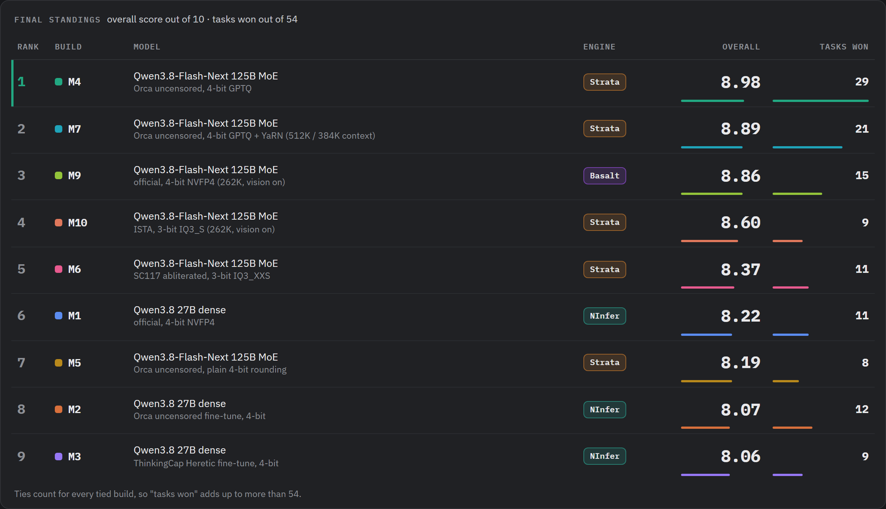
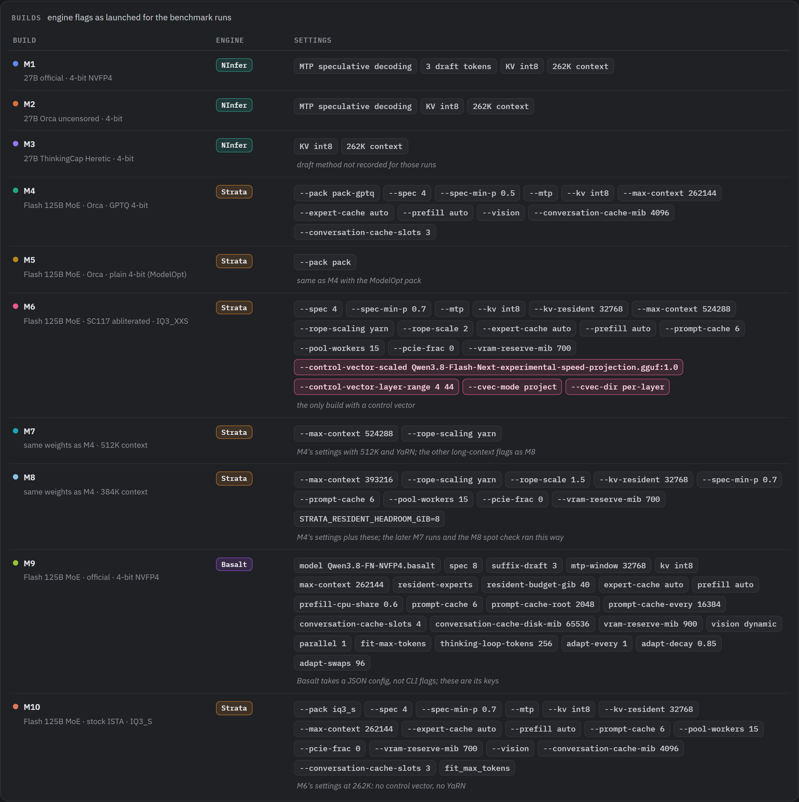

# Qwen3.8 本地模型基准测试 — 10 个构建，54 个真实任务

<p align="center">
  
  
  
  <a href="https://huggingface.co/Cracked-ANJ/Orca-Qwen3.8-Flash-Next-Abliterated-NVFP4-GPTQ-Strata"></a>
  <a href="https://creativecommons.org/licenses/by/4.0/"></a>
</p>

<table width="100%">
  <tr>
    <td width="120"><a href="README.md">English</a> | 中文</td>
    <td align="center">
      <a href="https://adithyanraj03.github.io/Qwen-3.8-Local-Benchmark/"></a>
      <a href="https://adithyanraj03.github.io/Qwen-3.8-Local-Benchmark/#leaderboard"></a>
    </td>
    <td width="120"></td>
  </tr>
</table>

十个 Qwen3.8 构建，各自独立运行相同的 54 个动手任务：游戏与 3D 世界、SVG 与着色器、网页应用与扩展、C++/Rust/Go、重构与查错、LaTeX 论文与研究写作。全部在一块 RTX 5090（64 GB 内存）上运行。每个结果都经过手工重建、运行、录制与评分，所有者亲自试玩并评定了每一个游戏、3D、声音与设计任务。

**在线报告：** [adithyanraj03.github.io/Qwen-3.8-Local-Benchmark](https://adithyanraj03.github.io/Qwen-3.8-Local-Benchmark/)。全部 486 次运行的分数、录制、笔记与可玩演示。

## 最终排名



## 评分方式

每次运行按五个维度评分：视觉、提示遵循、输出、创意，以及半权重的代码。纯代码任务的视觉与创意为 n/a。视觉错误与缺陷会扣分，每项扣分都写在该运行的卡片上。

## 各构建的运行设置

来自宿主机上的 Strata 启动文件与 Basalt 配置，以及推理监视器对 OpenCode 运行（2026 年 10 月 9 日 – 11 月 2 日；M9 与 M10 为 11 月 25–27 日）的请求历史。

[](https://adithyanraj03.github.io/Qwen-3.8-Local-Benchmark/#settings)

- 所有构建：RTX 5090 + 64 GB 内存，KV 缓存 int8，开启视觉。
- **M2 使用 MTP，而非 DFlash2。** 27B Orca 在本机的首次 DFlash2 运行是在 2026 年 11 月 3 日，晚于 OpenCode 运行。
- **M6 是唯一使用控制向量的构建**（作用于第 4–44 层的速度投影 steering 向量）。阅读其速度与结果时请留意这一点。
- **采样**未被服务器记录；来自测试机上的 OpenCode 配置：build agent 温度 0.6，top_p 0.95，开启自动压缩并保留 32,768 token。给 OpenCode 的上下文窗口：27B 构建 200K，M4、M5、M9 与 M10 250K，M6 以及 512K 的 M7 500K，M8（384K）380K。
- **M9 运行在 Basalt 上**，是唯一不在 NInfer 或 Strata 上的构建。Basalt 使用 JSON 配置而非命令行参数；图中列出的是它的配置键。

## 模型权重

- M4（Qwen3.8-Flash-Next 125B MoE · Orca uncensored，4-bit GPTQ · Strata）：[Hugging Face 权重](https://huggingface.co/Cracked-ANJ/Orca-Qwen3.8-Flash-Next-Abliterated-NVFP4-GPTQ-Strata)。

## 报告内容

- 排行榜、分数矩阵、分类与图表视图
- 模型档案与每个任务的最佳运行
- 每次运行的卡片：视频、静帧、需求清单与完整笔记
- 每次运行的会话日志
- 可在浏览器中试玩的在线演示：网页、Three.js 场景、Godot 游戏、PDF
- 幻觉研究
- 硬件与引擎细节
- 原始数据（分数、理由、每次运行统计、速度基准）CSV/JSON，见 [data/](data/)

## 说明

- 两个原生 C++ 游戏（P3 拉力赛、P5 滑板）无法在浏览器运行。其“Launch game”按钮仅在所有者本机有效；在网站上请观看录制。
- 幻觉部分中的 Alibaba URL 抓取属于普通的 URL 幻觉（虚构链接），并非数据泄露。报告中有解释。
- 站点为静态：无跟踪、无服务器、无构建步骤。

## 本地运行

下载或克隆本仓库，用 Chrome 或 Edge 打开 `index.html`。仓库包含约 575 MB 的录制与演示资源，克隆体积较大。

## 支持

如果这份报告对你有用，欢迎通过仓库顶部的 **Sponsor** 按钮赞助所有者。

## 许可证

© 2026 Adithya N Raj。以 [知识共享署名 4.0 国际许可协议（CC BY 4.0）](LICENSE) 发布。你可以复制、修改、再分发并以任意目的（包括商业）使用这里的一切，**但必须署名**：注明 Adithya N Raj、链接到本仓库，并说明是否做了修改。

可直接粘贴的署名行：

```
Qwen3.8 local model benchmark by Adithya N Raj (https://github.com/adithyanraj03/Qwen-3.8-Local-Benchmark), licensed under CC BY 4.0.
```

在线演示使用的第三方库（从 cdnjs 加载的 Three.js、内置 PDF.js 查看器、Godot web 运行时）保留各自的许可证。